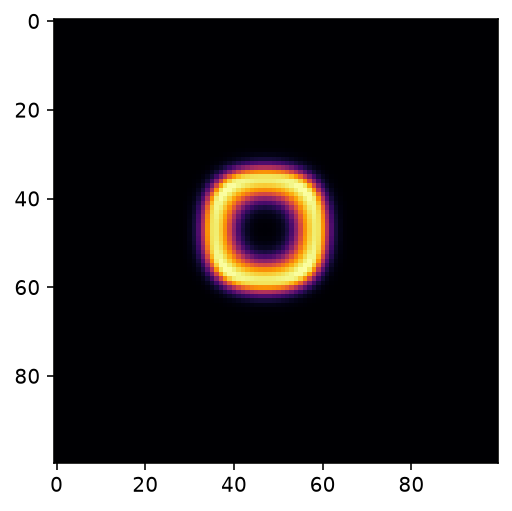
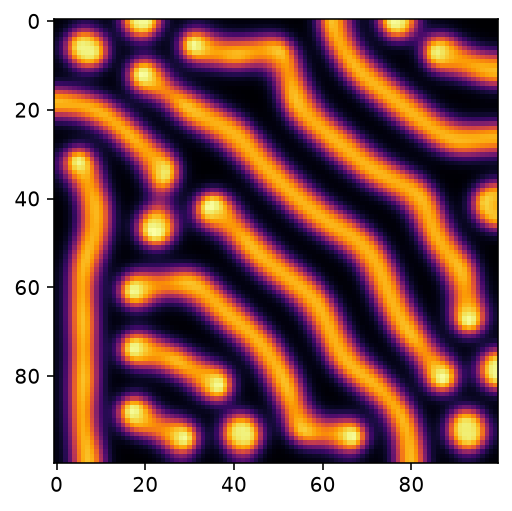
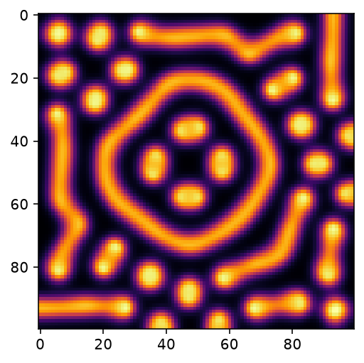
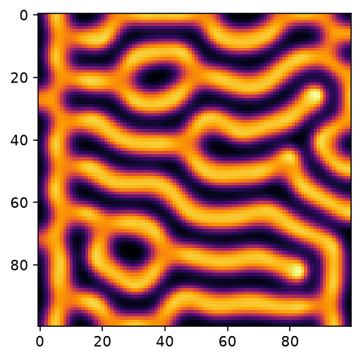
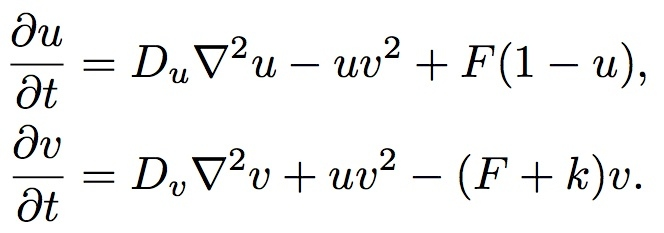

# GrayScottModelSimulation
Simulation des Gray Scott Models in Python 
 

Das Model beschreibt das Verhalten zweier Substanzen U und V. Dabei reagiert U zu V.  
Das Verhalten beider Stoffe kann durch zwei Gleichungen angegeben werden, die die jeweilige Änderungsrate der Stoffe beschreibt:  

 
Implementiert ist die Simulation auf zwei numpy Arrays. Jeden Simulationsschritt wird die Änderungsrate für die Substrate errechnet und auf das entsprechende Array addiert. 
Verschiedene Parameter können die Reaktionsgeschwindigkeit und -charakteristiken verändern: *f* gibt die Feed-Rate an, wie schnell das Substrat U sich wieder regeneriert, *k* gibt die Kill-rate an, wie schnell der entstandene Stoff V wieder verschwindet.  
Durch Anpassung dieser Parameter können auf ganz natürliche Weise spannende Muster entstehen. Wie oben in den Bildern gezeigt, entstehen Labyrinth-, Zebra- oder andere Muster.
